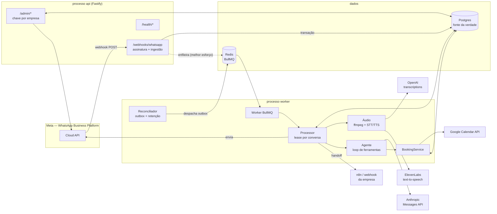
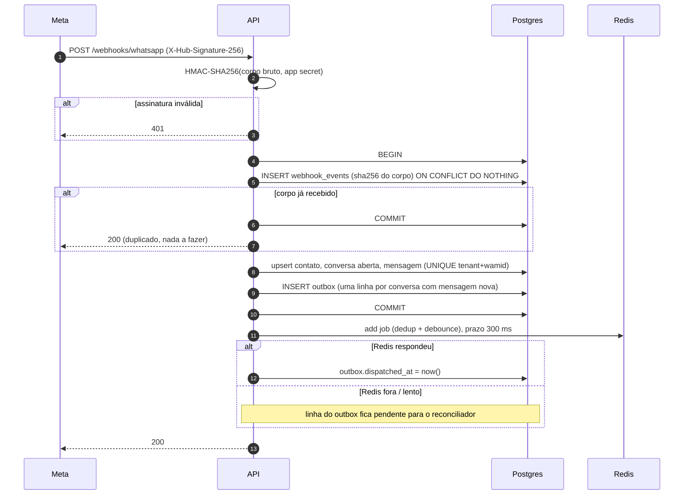
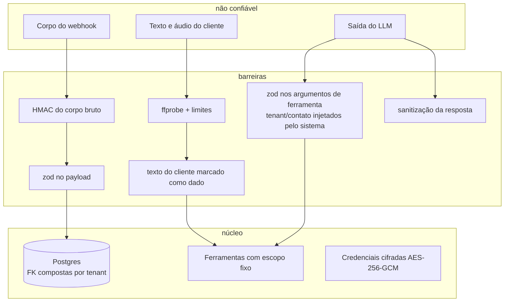

# 2. Arquitetura

Monólito modular com **dois processos** a partir do mesmo código: `api` (recebe webhooks) e `worker` (processa conversas). Postgres é a fonte da verdade; Redis/BullMQ é só o mecanismo de entrega de trabalho. Nada de microsserviços.

## Componentes



## Fluxo síncrono: webhook (alvo: dezenas de milissegundos)



Se o Postgres falhar, a resposta é 500 e a Meta reentrega (até 7 dias, segundo a documentação). Se só o Redis falhar, a resposta é 200: o evento já está seguro no banco.

## Fluxo assíncrono: processamento da conversa

```mermaid
sequenceDiagram
  autonumber
  participant Q as BullMQ
  participant W as Worker
  participant P as Postgres
  participant S as STT
  participant L as LLM
  participant C as Calendar
  participant M as Meta
  Q->>W: job {tenantId, conversationId} (após debounce)
  W->>P: UPDATE conversations SET lease (se livre)
  alt lease ocupado
    W->>Q: moveToDelayed(+1,5s)
  end
  W->>P: reenvia respostas pendentes (falha anterior)
  loop até 3 rodadas enquanto houver mensagens pendentes
    W->>P: mensagens recebidas não processadas
    opt áudio
      W->>M: GET /{media-id} → URL (5 min)
      W->>M: GET URL (limite de bytes)
      W->>W: ffprobe (formato, duração)
      W->>S: transcrição (MP3 mono)
    end
    alt modo humano / IA desligada / mensagens > 24h
      W->>P: marca processadas sem responder
    else pedido de atendente
      W->>P: status = human + aviso
    else orçamento diário esgotado
      W->>P: handoff
    else
      W->>L: system + histórico + ferramentas
      loop até N iterações
        L-->>W: tool_use
        W->>W: valida argumentos (zod)
        W->>C: freeBusy / insert (se ferramenta de agenda)
        W->>L: tool_result
      end
      L-->>W: texto final
    end
    W->>P: BEGIN; INSERT mensagem de saída (pending); marca entradas processadas; COMMIT
    W->>M: POST /{phone-number-id}/messages
    W->>P: status = sent + wamid
  end
  W->>P: libera lease
```

## Decisões principais

| Decisão | Motivo |
|---|---|
| Postgres como fonte da verdade, Redis só como "campainha" | Perder Redis não perde mensagens. O worker sempre lê do banco o que está pendente; o conteúdo do job é só `{tenantId, conversationId}`. |
| Outbox transacional + reconciliador | Garante que todo evento gravado gera processamento, mesmo com Redis fora ou job perdido. O reconciliador também reenfileira conversas com mensagens paradas além de `DEBOUNCE_MS + LEASE_MS`. |
| Debounce do BullMQ (`deduplication` com `ttl`, `extend`, `replace` + `delay`) | Agrupa rajadas de mensagens num job por conversa. Mensagens que chegam durante o processamento são pegas pelo laço de rodadas ou pelo reconciliador. |
| Lease por conversa no Postgres (não lock de Redis) | Um único worker por conversa, com expiração automática se o processo morrer. Funciona mesmo com o Redis instável. |
| Constraint de exclusão (`btree_gist`) em `bookings` | A garantia contra duplo agendamento fica no banco, não no código. |
| IDs de evento determinísticos no Google (`air` + uuid em hex) | Repetir a criação após timeout não duplica o evento; o serviço confere se ele já existe. |
| Chamada direta à Google Calendar API em vez de MCP | O modelo não fala com a agenda: só chama ferramentas próprias, validadas e com escopo fixo. Um servidor MCP acrescentaria um salto e uma superfície de permissão sem ganho no MVP. As mesmas ferramentas podem ser expostas como servidor MCP depois, se fizer sentido. |
| n8n só na notificação de handoff | É onde ele traz benefício concreto (repassar para Telegram/e-mail sem código). O caminho crítico não depende dele. |
| `fetch` nativo em vez de SDKs dos provedores | Menos dependências, comportamento de timeout/erro uniforme, fácil de testar com `fetch` simulado. Exceção: `google-auth-library` para o fluxo JWT da conta de serviço. |
| SQL puro (`pg`) em vez de ORM | Recursos usados (ON CONFLICT parcial, EXCLUDE, advisory lock, lease com UPDATE…RETURNING) ficam explícitos e testáveis. |

## Fronteiras de segurança



- O modelo **não tem** acesso a banco, rede, arquivos ou credenciais: só às 9 ferramentas listadas em `docs/06-orquestracao-ia.md`, cujo código decide o que consultar.
- Download de mídia só de hosts da Meta (proteção contra SSRF), sem seguir redirecionamentos.
- Credenciais de terceiros por empresa ficam cifradas no banco; segredos da aplicação, em variáveis de ambiente.

## Implantação sugerida (enxuta)

Uma VM ou um serviço de contêiner (ex.: Cloud Run para a API + uma instância sempre ligada para o worker), Postgres gerenciado e Redis gerenciado com persistência. A API precisa estar acessível por HTTPS para a Meta. Escala horizontal: várias instâncias de API e de worker funcionam sem coordenação extra (lease, advisory lock e deduplicação já cobrem concorrência).
