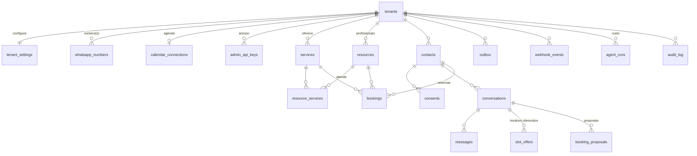

# 3. Modelo de dados

Fonte: `migrations/001_init.sql` (PostgreSQL 16, extensões `btree_gist` e `pgcrypto`).



## Tabelas

| Tabela | Finalidade | Chaves e índices relevantes |
|---|---|---|
| `tenants` | Empresa cliente | `slug` único |
| `tenant_settings` | Liga/desliga IA, agenda e voz; informações aprovadas; expediente; antecedência; horizonte; **orçamento diário de LLM**; duração máxima de áudio; retenção; URL de handoff | PK = `tenant_id` |
| `services` | Serviços com duração e preço aprovado (texto) | `UNIQUE (tenant_id, lower(name))`; `UNIQUE (id, tenant_id)` para FKs compostas |
| `resources` | Profissional/cadeira/sala com agenda própria | `UNIQUE (tenant_id, external_calendar_id)` |
| `resource_services` | Quem atende o quê | PK `(resource_id, service_id)`; FKs compostas com `tenant_id` |
| `whatsapp_numbers` | Roteamento do webhook (`phone_number_id` → empresa) e token cifrado | `phone_number_id` único |
| `calendar_connections` | Provedor de agenda e credencial cifrada | uma por empresa |
| `admin_api_keys` | Acesso administrativo por empresa (só o hash SHA-256 da chave) | `key_hash` único |
| `contacts` | Cliente final por empresa | `UNIQUE (tenant_id, wa_id)` |
| `consents` | Registro de aviso/consentimento (somente inserção) | índice `(tenant_id, contact_id, kind, created_at)` |
| `conversations` | Estado (`bot`, `human`, `closed`), motivo do handoff, **lease** de processamento | índice único parcial: **uma conversa aberta por contato** |
| `messages` | Entradas e saídas, transcrição, status de entrega | `UNIQUE (tenant_id, wa_message_id)` parcial (**deduplicação**); índice parcial de pendentes |
| `webhook_events` | Evento bruto recebido | `body_sha256` único (**reentrega idêntica**) |
| `outbox` | Trabalho a enfileirar no Redis | índice parcial dos não despachados |
| `slot_offers` | Horários que o sistema ofereceu numa conversa (código curto, expira em 30 min) | PK `(conversation_id, code)` |
| `booking_proposals` | Proposta de criar/remarcar/cancelar aguardando confirmação do cliente | índice `(conversation_id, created_at)` |
| `bookings` | Reservas | `proposal_id` único (**idempotência**); **constraint de exclusão** contra sobreposição |
| `agent_runs` | Uma linha por execução do agente: modelo, iterações, tokens, **custo** | índice `(tenant_id, started_at)` para o orçamento diário |
| `audit_log` | Ações relevantes (handoff, reservas, exclusões, ações de admin), sem conteúdo de mensagens | trigger impede UPDATE/DELETE fora do job de retenção |
| `schema_migrations` | Controle de migrações | — |

### Restrições que carregam regra de negócio

```sql
-- nenhuma sobreposição de reservas ativas no mesmo recurso
CONSTRAINT bookings_no_overlap EXCLUDE USING gist (
  resource_id WITH =, tstzrange(starts_at, ends_at, '[)') WITH &&
) WHERE (status IN ('pending','confirmed'))

-- deduplicação de mensagens da Meta
CREATE UNIQUE INDEX messages_wamid_uq ON messages (tenant_id, wa_message_id) WHERE wa_message_id IS NOT NULL;

-- uma conversa aberta por contato
CREATE UNIQUE INDEX conversations_one_open_uq ON conversations (tenant_id, contact_id) WHERE status <> 'closed';
```

O intervalo `[)` permite reservas encostadas (10:00–11:00 e 11:00–12:00). Reservas com status `failed` ou `cancelled` não bloqueiam o horário.

## Isolamento entre empresas

Três camadas:

1. **Banco:** toda tabela de negócio tem `tenant_id`, e as relações filhas usam **chave estrangeira composta** `(id, tenant_id)`. Assim, é impossível gravar uma mensagem de uma empresa numa conversa de outra, ou uma reserva com serviço de outra empresa — o Postgres recusa (há teste para isso).
2. **Código:** toda consulta recebe o `tenant_id` do contexto do job ou da chave administrativa; ferramentas do agente recebem tenant, conversa e contato injetados pelo sistema, nunca pelo modelo; reservas só são encontradas filtrando também por `contact_id`.
3. **Credenciais:** cada empresa tem seu token da Meta e sua credencial de agenda, cifrados separadamente.

Próximo passo opcional (fase de multiempresa): Row-Level Security com `SET app.tenant_id` por transação, como cinto de segurança adicional.

## Políticas de retenção (padrão)

Executadas a cada hora pelo worker (`src/worker/retention.ts`):

| Dado | Retenção | Ação |
|---|---|---|
| Áudio recebido ou gerado | Não armazenado | Processado em memória e em arquivo temporário privado apagado em seguida |
| Texto e transcrição de mensagens | `tenant_settings.message_retention_days` (padrão 90) | Conteúdo apagado (`redacted_at`), metadados mantidos |
| Payload bruto de webhook | 7 dias | `payload = NULL` |
| Linha de `webhook_events` | 30 dias | removida |
| `slot_offers` expirados | 1 dia após expirar | removidos |
| `audit_log` | 365 dias | removido pelo job (única exceção à imutabilidade) |
| Reservas | Mantidas (obrigação operacional da empresa) | Na exclusão a pedido, o nome é removido |

`STORE_WEBHOOK_PAYLOADS=false` desliga a gravação do payload bruto desde o início.
