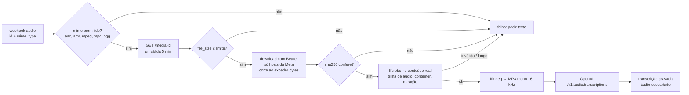
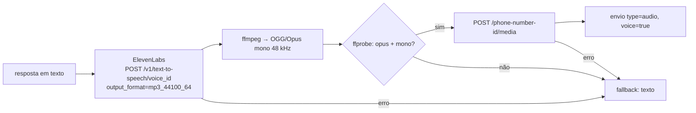

# 5. Processamento de áudio

Código: `src/audio/inbound.ts`, `src/audio/ffmpeg.ts`, `src/audio/stt.ts`, `src/audio/tts.ts`.

## Entrada (nota de voz → texto)

Detalhes verificados na documentação:

- **Obtenção segura:** `GET /{media-id}?phone_number_id=…` devolve `url`, `mime_type`, `sha256`, `file_size`. A URL expira em 5 minutos e o download exige o mesmo token Bearer. O campo `url` dentro do webhook está em liberação gradual, por isso usamos o fluxo pelo id.
- **Formatos aceitos pela Meta:** `audio/aac`, `audio/amr`, `audio/mpeg`, `audio/mp4`, `audio/ogg` (só Opus, mono), até 16 MB.
- **STT:** a API de transcrição da OpenAI aceita `mp3, mp4, mpeg, mpga, m4a, wav, webm` e até 25 MB — **não inclui OGG**, que é o formato das notas de voz do WhatsApp. Por isso todo áudio é convertido para MP3 mono antes do envio (teste confirma o codec e os canais do arquivo enviado).
- **Validação pelo conteúdo, não pelo cabeçalho:** `ffprobe` confirma que há trilha de áudio, rejeita vídeo e mede a duração real.

Limites: `AUDIO_MAX_BYTES` (padrão 16 MB) e `tenant_settings.max_audio_seconds` (padrão 120 s). Os arquivos temporários ficam num diretório privado (`0600`) apagado em seguida — necessário porque MP4/M4A não pode ser lido por *pipe*.

### Falhas

| Falha | Resultado |
|---|---|
| Tipo não suportado, corrompido, longo demais, grande demais, hash diferente, transcrição vazia | Mensagem marcada `failed` com o motivo; o cliente recebe "Não consegui ouvir seu áudio. Você pode escrever?" |
| STT temporariamente fora (5xx/429/timeout) | Job repetido; na última tentativa, mesma resposta de contingência |
| STT desligado (`STT_PROVIDER=disabled`) | Pede para escrever |

## Saída opcional (texto → voz)

Só acontece quando **a empresa habilitou** (`voice_reply_enabled`), **o cliente mandou áudio** na mensagem mais recente e o texto tem até `TTS_MAX_CHARS` (600) caracteres.

A Meta exige OGG com codec Opus para mensagens de voz. A ElevenLabs oferece formatos `opus_48000_*`, mas a documentação não especifica o contêiner nem os canais desses formatos; por isso pedimos MP3 e **normalizamos com ffmpeg**, validando o resultado antes do upload. Qualquer falha na voz cai para texto — o cliente sempre recebe resposta.

Observação da documentação da Meta: o ícone de reprodução da nota de voz só aparece para arquivos até 512 KB; com 24 kbps, 600 caracteres ficam bem abaixo disso.
