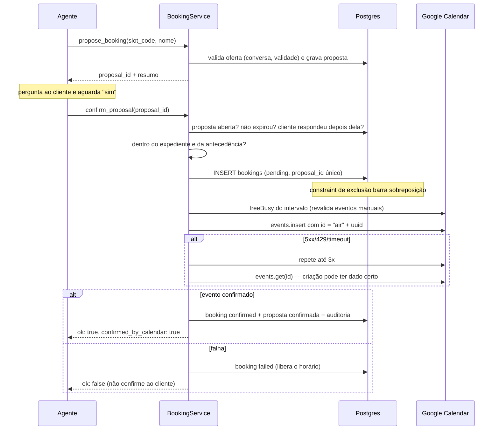

# 7. Google Calendar (e MCP)

Código: `src/calendar/google.ts`, `src/calendar/booking-service.ts`, `src/calendar/availability.ts`, `src/calendar/time.ts`.

## Autenticação e escopos mínimos

- **MVP:** conta de serviço do Google Cloud. A empresa compartilha a(s) agenda(s) dos profissionais com o e-mail da conta de serviço, com permissão "Fazer alterações nos eventos". Opcional em Google Workspace: delegação em todo o domínio (`subject`).
- Fluxo: JWT assinado pela conta de serviço → token de acesso (biblioteca oficial `google-auth-library`).
- **Escopos solicitados:**
  - `https://www.googleapis.com/auth/calendar.events` — `events.insert`, `events.get`, `events.delete`;
  - `https://www.googleapis.com/auth/calendar.freebusy` — `freeBusy.query`.
  Ambos aparecem na lista de escopos aceitos pelos respectivos métodos na referência oficial. Não pedimos `calendar` (acesso total) nem acesso a contatos/e-mail.
- Alternativa ainda mais restrita a avaliar: `calendar.events.owned` (só eventos de agendas próprias). Não adotada sem teste real, porque o comportamento com agendas compartilhadas com a conta de serviço não foi verificado.
- A credencial fica cifrada (AES-256-GCM) em `calendar_connections.credentials_ciphertext`.
- **Pendente:** OAuth do próprio dono do salão (para quem usa Gmail pessoal sem Workspace) — exige tela de consentimento e guarda de refresh token.

## Isolamento das agendas

- Cada empresa tem **uma** conexão; cada profissional (`resources.external_calendar_id`) aponta para uma agenda.
- O provedor é resolvido por `tenant_id` do job; uma empresa nunca consulta agenda de outra.
- A conta de serviço só enxerga agendas explicitamente compartilhadas com ela. Recomendação: **uma conta de serviço por empresa** em produção, para que a revogação de uma não afete as outras.

## Fluxos

### Consultar disponibilidade

1. Valida serviço e data (hoje até `booking_horizon_days`).
2. `freeBusy.query` para as agendas dos profissionais que fazem o serviço (`timeMin`/`timeMax` do dia no fuso da empresa).
3. Soma com as reservas ativas do próprio banco.
4. Gera horários dentro do expediente (`business_hours`), com passo `slot_step_minutes`, duração do serviço e antecedência mínima.
5. Grava até 6 em `slot_offers` com código curto e devolve ao modelo.

Erro no freeBusy (inclusive erro por agenda dentro de uma resposta 200) é tratado como **indisponível**, nunca como livre.

### Confirmar dados e criar

O id do evento usa só caracteres do alfabeto base32hex (`a`–`v`, `0`–`9`), entre 5 e 1024 caracteres, como exige a referência de `events.insert`. Como a documentação avisa que colisões de id podem não ser detectadas na criação, o serviço também confere com `events.get` antes de declarar falha e trata `409` como "já existe" somente após confirmar o evento.

### Consultar, remarcar e cancelar

- `list_my_bookings`: reservas confirmadas e futuras **do contato**.
- Remarcação: cria a nova reserva pelo mesmo fluxo e, só depois de confirmada, remove o evento antigo e marca a reserva como cancelada. Se a remoção falhar, devolve `handoff_required` (o cliente fica com o novo horário, a equipe resolve o antigo).
- Cancelamento: `events.delete` (com `sendUpdates=none`); 404/410 contam como já removido.

## Recuperação de conflitos

| Conflito | Tratamento |
|---|---|
| Dois clientes confirmam o mesmo horário ao mesmo tempo | Postgres aceita um; o outro recebe `slot_taken` e a IA oferece alternativas (teste de concorrência com mutação) |
| Equipe marca manualmente no Google entre a oferta e a confirmação | Revalidação via freeBusy detecta; reserva vira `failed`; `slot_taken` |
| Timeout depois de o Google ter criado o evento | `events.get` encontra o evento; reserva confirmada sem duplicar |
| Repetição do job após crash | `proposal_id` único em `bookings` + id determinístico no Google |
| Falha permanente (credencial revogada, 403) | Reserva `failed`, IA informa que não conseguiu e transfere |

## MCP

Decisão do MVP: **não usar servidor MCP** no caminho de agendamento. O modelo não precisa falar diretamente com a agenda — e não deve: as regras de confirmação, isolamento e idempotência ficam no `BookingService`. Usar um MCP de calendário genérico daria ao modelo operações amplas (listar/editar qualquer evento) que teríamos de bloquear de novo.

Quando fizer sentido (ex.: expor o recepcionista para outros agentes da CazaTech ou para o OpsMind), o caminho é **publicar as nossas próprias ferramentas** como um servidor MCP, com o mesmo contrato e as mesmas validações, autenticado por empresa.

## Integração futura com o Bladiq

O Bladiq já tem motor de disponibilidade e reservas próprios. Para salões que usam o Bladiq, o recepcionista deve agendar **no Bladiq**, não no Google. Basta implementar `CalendarProvider` (ou um `BookingProvider` mais alto nível) chamando a API do Bladiq.
